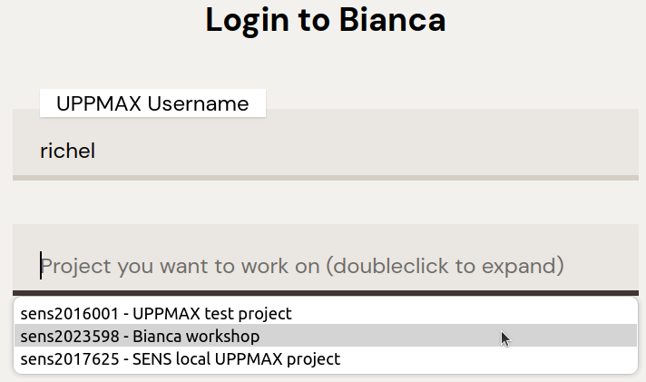

---
tags:
  - Slurm
  - Bianca
---

# Using Slurm on Bianca

This page describes how to use Slurm on Bianca.

???- question "What is Slurm?"

    See [the general page on Slurm](slurm.md)

???- question "What is Bianca?"

    See [the general page on Bianca](bianca.md)

See [Slurm troubleshooting](slurm_troubleshooting.md)
how to fix Slurm errors.

## `sbatch` (and `interactive`) on Bianca

`sbatch` (and `interactive`) work the same as on [Pelle](pelle.md).

???- question "Want to start an interactive session?"

    See [how to start an interactive session on Bianca](start_interactive_session_on_bianca.md)

Here it is shown how to submit a job with:

- command-line Slurm parameters
- Slurm parameters in the script

## `sbatch` a script with command-line Slurm parameters

The minimal command to use `sbatch` with command-line Slurm parameters is:

``` bash
sbatch -A [project_code] [script_filename]
```

where `[project_code]` is the project code, and `[script_filename]`
the name of a bash script, for example:

``` bash
sbatch -A sens2017625 my_script.sh
```

???- question "Forgot your Bianca project?"

    When [login to Bianca's remote desktop environment](../getting_started/login_bianca.md)
    webpage at [https://bianca.uppmax.uu.se](https://bianca.uppmax.uu.se) is
    helpful in showing you your Bianca projects:

    

    > An example of the Bianca projects for this user

???- question "What is in the script file?"

    The script file `my_script.sh` is a minimal example script.
    Such a minimal example script could be:

    ```bash
    #!/bin/bash
    echo "Hello"
    ```

Again, what is shown here is a minimal use of [`sbatch`](../software/sbatch.md).

## `sbatch` a script with Slurm parameters in script

The minimal command to use `sbatch` with Slurm parameters in the script:

``` bash
sbatch [script_filename]
```

where `[script_filename]` the name of a bash script, for example:

``` bash
sbatch my_script.sh
```

The script must contain at least the following lines:

```text
#SBATCH -A [project_code]
```

where `[project_code]` is the project code, for example:

```text
#SBATCH -A sens2017625
```

???- question "Forgot your Bianca project?"

    When [login to Bianca's remote desktop environment](../getting_started/login_bianca.md)
    webpage at [https://bianca.uppmax.uu.se](https://bianca.uppmax.uu.se) is
    helpful in showing you your Bianca projects:

    

    > An example of the Bianca projects for this user

A full example script would be:

```bash
#!/bin/bash
#SBATCH -A sens2017625
echo "Hello"
```

Again, what is shown here is a minimal use of `sbatch`.
See the [general page on Slurm](slurm.md).

## Bianca's Quality of Service flags

Quality of Service flags helps to make HPC clusters be nicer to work with.
For example, if you state your job is short, it may get higher priority.
The most important example is when to start an interactive job:

```bash
interactive -A [your_bianca_project] --qos=interact
```

where `[your_bianca_project]` is your Bianca project, for example:

```
interactive -A sens123456 --qos=interact
```

With the `--qos=interact` you are allowed to book a 12 hour session
and you will get it a higher priority.

`qos` option |Scheduling policy
-------------|------------------
`short`      |Maximum 15 minutes
`normal`     |Maximum 1 hour
`interactive`|Maximum 12 hours

## [More about slurm on Bianca](slurm_on_bianca_details.md)
