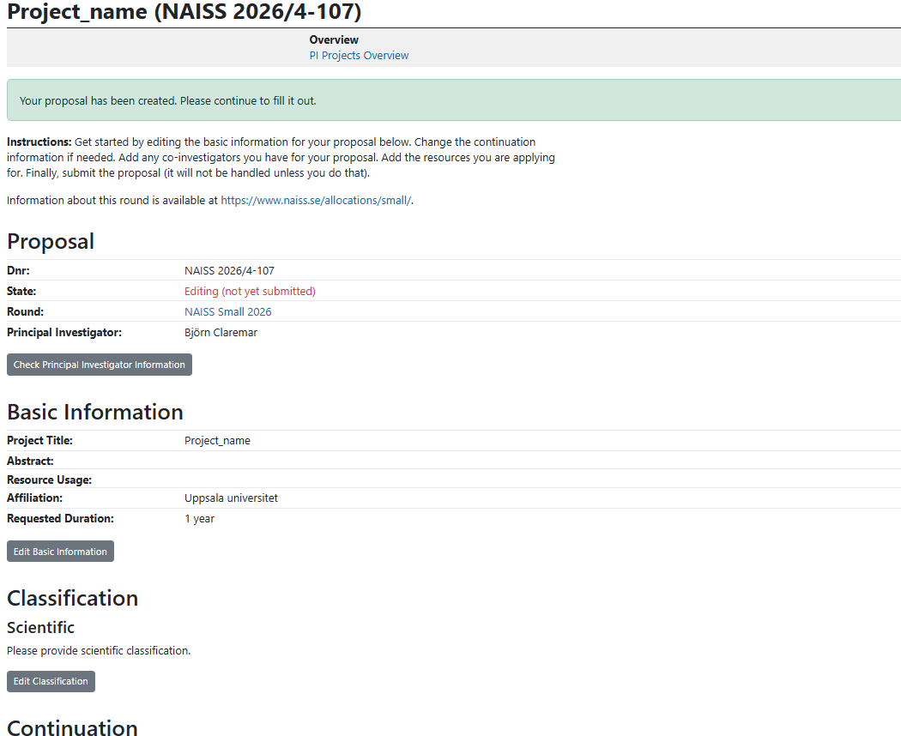
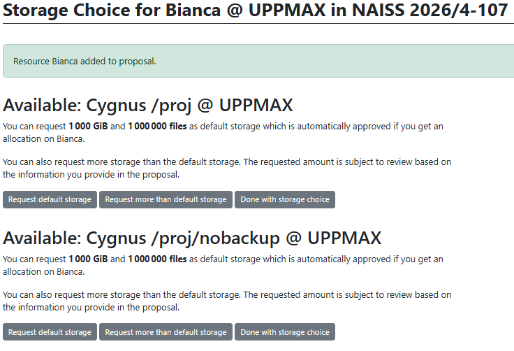
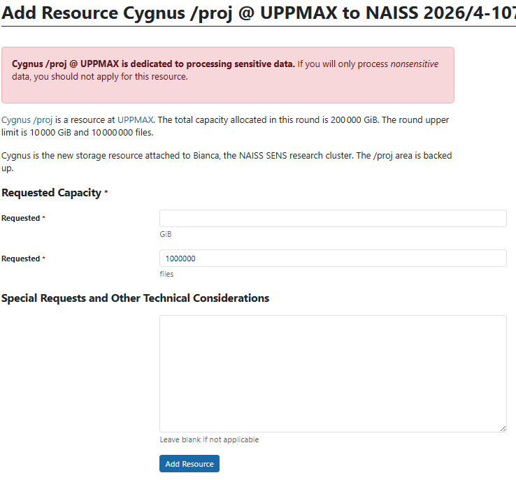
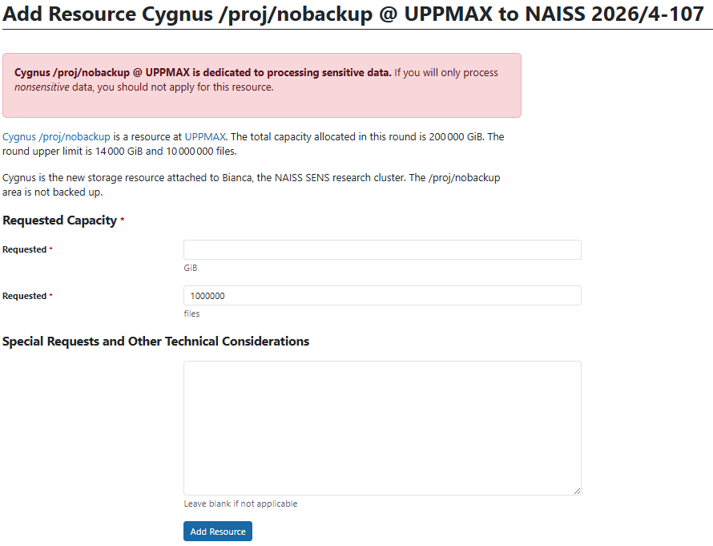
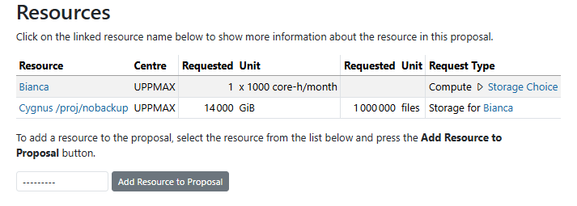
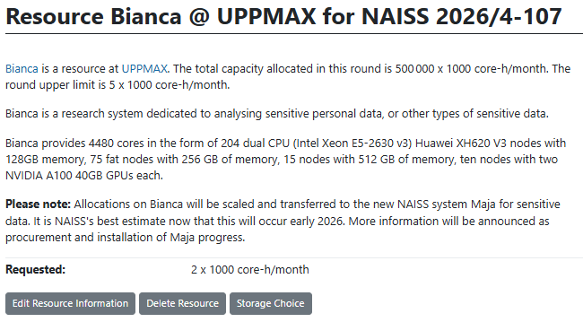
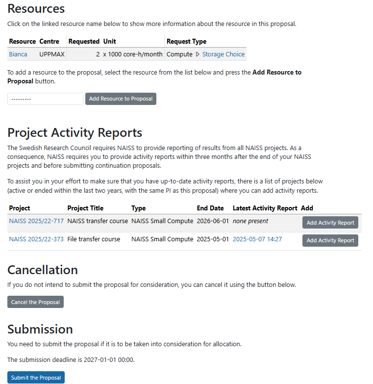

---
tags:
  - project
  - apply
  - application
  - Bianca
---

# Project application for Bianca

To use an UPPMAX cluster, one [needs to apply to a project](project_apply.md).

This page describes how to apply to a Bianca project. Note that it is no longer possible to apply for Bianca through NAISS.

## Procedure for project application

### 1. Go to [UPPMAX Local SENS](https://supr.naiss.se/round/uppmaxlocalsens) round in SUPR

### 2. Click 'Create New Proposal for UPPMAX Local SENS'

In the 'Open for Proposals' screen you can view which resources are available (and also click for details) but to create a new proposal click 'Create New Proposal for UPPMAX Local SENS'.

### 3. Add a project title and click 'Create new proposal'

In the 'Create New Proposal for UPPMAX Local SENS', add a project title and click 'Create new proposal'

This leads you to the next page, the proposal details.

???- question "What does that look like?"

    

    > A  project

<!-- markdownlint-disable MD029 --> <!--ordered-list-prefix Ordered list item prefix-->

!!! tips

    1. Project Title should be the topic of your activity.
    2. Edit Basic Information.
    
        - Abstract should summarise your research plan
        - Resource usage should summarise the compute and storage resources your project will need. Describe the software you will use and how you will use it.
        - Data management plan should contain an abbreviated data management plan. Answer the questions included in the instructions. If you have an online DMP, you may link to it.
        - Sensitive data handling When you add Bianca resources (in step 5), you have to complete this field.
        
    3. Add co-investigators (if any).
    4. If someone other than the PI needs control over the project, assign a co-investigator the role of proxy.

### 4. Edit resources

Under the 'Resources' section, adjust the resources from the default.

Set the number of thousands of core hours/months for Bianca according to the maximum amount of core-hours you expect to use in a month.

Set the Requested Capacity backed up storage (Cygnus /proj) and no-backup storage (Cygnus /proj/nobackup). Note that the file transfer area (or Wharf) is located on no-backup storage.

!!! tip

    - Add the Cygnus /proj resource and set the Requested Capacity to your amount of raw data. You may ignore the other fields.
    - Add the Cygnus /proj/nobackup resource and set the Requested Capacity to your estimated total minus your raw data. Include space for import and export of data through the Wharf. You may ignore the other fields.

???- question "What does that look like (Request more example)?"

    

    > In the 'Storage choice' page, click 'Request more...'

Request needed storage in terms of GiB and number of files for Backup

???- question "What does that look like?"

    

    > In the 'Add resource Cygnus /proj' menu, set the number of  GiB and number of files and click 'Add resource'

Request needed storage in terms of GiB and number of files for Non-backup

???- question "What does that look like?"

    

    > In the 'Add resource Cygnus /proj/nobackup' menu, set the number of  GiB and number of files and click 'Add resource'

### 5. Want to change your numbers?

You can go back and change your choices. In your NAISS project, scroll down to 'Resources' section to revisit the resources.

???- question "What does that look like?"

    

    > In your UPPMAX local compute project, revisit resources

Click Bianca or the Storage choice

???- question "What does that look like?"

    

    > Edit
    
### 6. Submit your proposal

Press the "Submit the Proposal" button on the bottom of the page.

???- question "What does that look like?"

    

    > Submit

### 7. Done

Now, you have submitted a proposal for Bianca. Well done!
